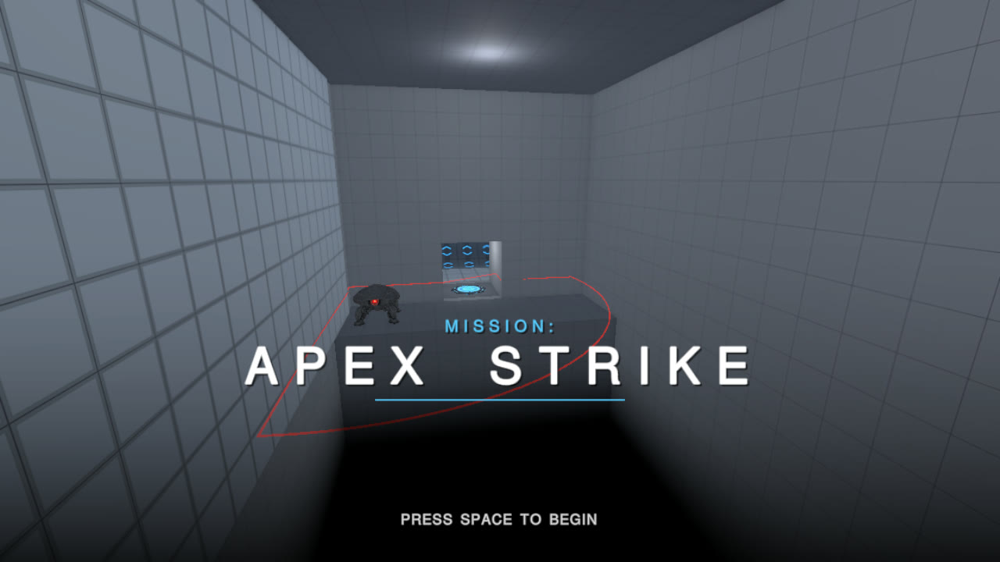
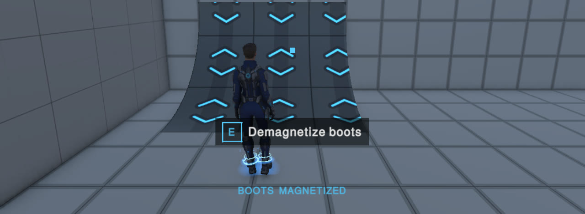
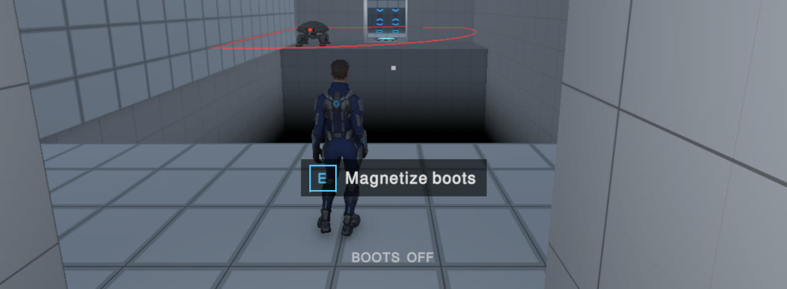
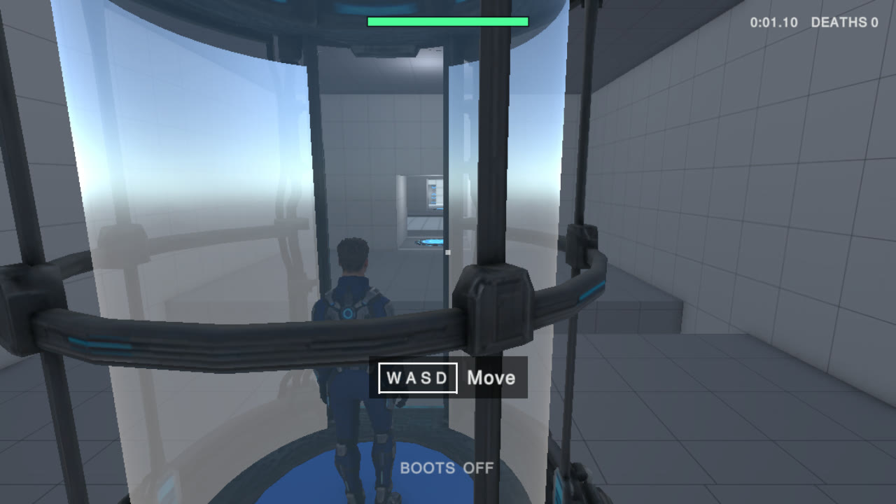
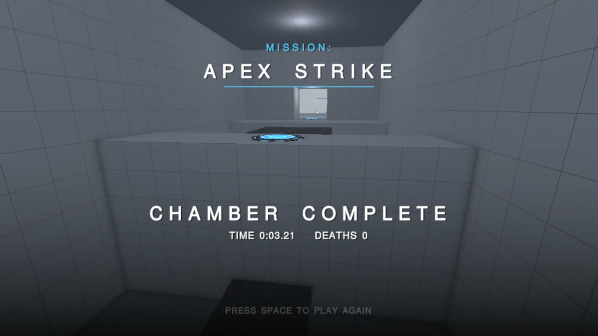

# Mission: Apex Strike

**[Play in your browser on itch.io](https://aembear.itch.io/mission-apex-strike)** ·
**[Master AI Prompt Log & Workflow Analysis](PROMPT_LOG.md)** ·
**Presentation: [PDF](presentations/Mission-Apex-Strike-Development.pdf) · [PowerPoint](presentations/Mission-Apex-Strike-Development.pptx)**



Magnetic boots let you walk up curved ramps onto walls and ceilings, and switching them off
drops you straight back to the floor. **Mission: Apex Strike** is a 3D puzzle obstacle course
through a chain of sci-fi test chambers: read which surfaces connect, cross death pits upside
down on moving shuttles, and drop at exactly the right moment, sometimes onto the head of a
laser sentry, the only way to destroy one.

Created by **William Edwards** for *AME 294: Games and AI*, built in Unity 6 with Claude Code,
Tripo and ElevenLabs.

## Presentation

A 7–10 minute talk on the game's mechanics and how it was built: the 3D asset workflow from
prompt to concept image to Tripo model, the problems human playtesting caught, and the
"Human First, AI in the Middle, Human Last" workflow. Speaker notes are in the PowerPoint.

- **[PDF slides](presentations/Mission-Apex-Strike-Development.pdf)**
- **[PowerPoint slides](presentations/Mission-Apex-Strike-Development.pptx)**, with speaker notes

## Play

- **Browser:** [aembear.itch.io/mission-apex-strike](https://aembear.itch.io/mission-apex-strike)
  (Unity WebGL; desktop browser with keyboard and mouse). Click the game to start; this also
  captures the mouse. Esc releases it.
- **From the project:** open it in Unity (below) and press Play in `Chamber_04`.

### Controls

| Action | Keyboard / mouse | Gamepad |
| :--- | :--- | :--- |
| Move | W A S D | Left stick |
| Look | Mouse (click to capture) | Right stick |
| Jump | Space | South button |
| Magnetize / demagnetize boots | E or right mouse button | Right trigger |
| Back to the last checkpoint | R | Select |
| Restart the chamber | Backspace | — |
| Release the mouse | Esc | Start |

### How it works

- **The boots only stick to magnetic surfaces:** the bright panels, and curves marked with blue
  chevrons. Switch them on while standing on one.
- **Orientation changes only along curves.** Walk up a quarter-pipe onto a wall, then onto the
  ceiling. A sharp corner between two surfaces is a dead end, by design.
- **Switch the boots off to drop.** You fall toward the world floor and land upright. While
  magnetized on a wall or ceiling, a marker shows where you'd land: blue for safe, red for a
  void, gold over a sentry.
- **Sentries** see and shoot only in a flat plane 1 m above the surface they stand on (the red
  line). One hit kills, and speed won't save you. Drop onto a sentry's dome to destroy it for good.
- **Checkpoints** glow green when reached. Moving platforms and shuttles run on a fixed clock
  that rewinds on respawn, so every attempt has the same timing.
- **Hints** appear when you need them: key prompts for moving, jumping and the boots, shown when
  you pause somewhere they apply.

| | |
| :---: | :---: |
|  |  |
|  |  |

### The chamber

Fourteen rooms joined by corridors with checkpoints, each introducing one idea and then
combining them: walking and jumping, the boots, the first curve, the ceiling, rounded edges, a
drop with stakes, elevators and ferries, an upside-down shuttle, sentries and stomping, a
finale, then three puzzles that combine everything. **Corkscrew** and **Diving Board** are
normal puzzles; **Gauntlet** is the challenge room: two shuttles that meet only in a shared
2-second pause, a drop onto a sentry on an island, and a running jump onto a second sentry. The
run starts and ends with a ride in a tube elevator. A scripted run completes the whole chamber
without dying, in about 225 s of game time. Room-by-room design notes are in
[docs/PLAN.md](docs/PLAN.md).

## Open and build the project

Requires **Unity 6000.5.9f1** (Unity 6) with the WebGL Build Support module for web builds.

1. Clone the repository and open its folder in Unity Hub.
2. Open `Assets/_Project/Levels/Chamber_04.unity` and press **Play**.

**Tests** (with the Editor closed): `unity test . --mode EditMode` and
`unity test . --mode PlayMode` using the Unity CLI, or the Test Runner window in the Editor.
62 EditMode and 282 PlayMode tests cover the motor at all six orientations, boots, camera,
movers, sentries, the game loop, footsteps and hints.

**Web build:** menu **GravBoots → Build for Web (itch.io)**, or headless with the Editor closed:

```sh
unity run . -- -executeMethod GravBoots.Editor.WebBuild.Build -logFile Logs/web-build-batch.log
```

This writes `Builds/WebGL/` and `Builds/MissionApexStrike-web.zip` (index.html at the root, as
itch.io expects; Gzip with decompression fallback, since itch.io doesn't set Content-Encoding).
Builds aren't committed.

**Editing levels:** chambers are hand-edited scenes built with the Level Kit (menu
**GravBoots → Level Kit**). See [docs/LEVEL_EDITING.md](docs/LEVEL_EDITING.md) and the sizes in
[docs/LEVEL_METRICS.md](docs/LEVEL_METRICS.md).

## Repository layout

| Path | Contents |
| :--- | :--- |
| `Assets/_Project/Art/` | Visual assets, one folder per asset. Each Tripo asset has `Reference/` (the generated concept images used as Tripo inputs) and `Model/` (the Tripo export, keeping Tripo's file names). |
| `Assets/_Project/Art/Characters/Player/` | Tripo player character (`Model/`), its Tripo animation clips (`Animations/<clip name>/`), Animator controller, boot effects |
| `Assets/_Project/Art/Hazards/Sentry/` | Tripo sentry model, and the body and head prefabs split from it |
| `Assets/_Project/Art/Level/` | Tripo elevator, checkpoint pad and platform decks; code-drawn curve panel textures |
| `Assets/_Project/Audio/` | ElevenLabs sound effects (`SFX/`) and music (`Background/`) |
| `Assets/_Project/Resources/SoundBank.asset` | Every sound and its volume, in one place |
| `Assets/_Project/Levels/` | Chambers; `Chamber_04` is the game |
| `Assets/_Project/Scenes/` | Generated test bed and a sandbox |
| `Assets/_Project/Scripts/Runtime/` | Game code (`GravBoots.*`): player motor and boots, gravity, camera, level and movers, hazards, audio, UI |
| `Assets/_Project/Scripts/Editor/` | Level Kit, model importers and builders, web build |
| `Assets/_Project/Tests/` | EditMode and PlayMode tests |
| `Assets/_Project/Shaders/` | The void darkness over pits |
| `docs/` | Plan, level editing guide, metrics, the raw prompt capture, screenshots |
| `scripts/` | Prompt log capture and the master log builder |

The `.gitignore` is Unity's standard one: `Library/`, `Temp/`, `Obj/`, `Logs/`, `UserSettings/`
and `Builds/` are not committed.

## AI tools and creative process

The game was made as a human–AI collaboration. William Edwards designed the game and its
puzzles, wrote the asset concepts, generated every 3D model and animation in Tripo, chose
between audio options, playtested each step and directed every change. The
[master prompt log](PROMPT_LOG.md) documents the prompts, Tripo assets, audio, error
recoveries and reflection; [docs/prompt-log.md](docs/prompt-log.md) is the raw capture of
every prompt and reply.

| Tool | Model / version | Used for |
| :--- | :--- | :--- |
| Claude Code (Claude desktop app) | Claude Opus 5.5 | All code, tests, level building, shader, audio wiring, UI, builds, documentation |
| Codex CLI (invoked by Claude Code) | GPT-6 Astra with the built-in `image_gen` tool (OpenAI GPT Image) | 17 concept images used as Tripo inputs |
| Tripo Studio (Pro plan) | P2.0 | Player character, rig and 8 animation clips; sentry; tube elevator; checkpoint pad; two platform decks |
| ElevenLabs Sound Effects API (Creator plan) | `eleven_text_to_sound_v2` | 13 in-game sound effects (723 credits over 31 generations) |
| ElevenLabs (Creator plan) | Eleven Music | Two background tracks |
| Unity 6000.5.9f1 | URP, Cinemachine, Input System, ProBuilder | Engine |

## Reference items

- **Concept:** an obstacle course built on magnetic boots: walk up ramps, along walls and
  across ceilings, and drop back to the floor on purpose. Hazards are death pits, laser
  enemies and moving elements that need precise timing. From the original brief: "3d with an
  over the shoulder view of the scene, the aesthetic is sci-fi/Portal style."
- **Gameplay references:** *Portal*'s test chambers (one idea per room, then combinations, and
  a clean, readable space).
- **Target look:** bright white panelled test chambers with dark machinery and glowing blue
  accents; magnetic surfaces as bright bevelled panels, curves marked by chevrons; red for
  danger (sentry lines, the lethal landing marker) and shadowed voids for pits.
- **Target sound:** subtle mechanical sci-fi: heel-toe footsteps on metal decks, a magnetic snap
  and hum for the boots, low and menacing sentries, quiet atmospheric music.
- **Moodboard:** the concept images in each asset's `Reference/` folder under
  `Assets/_Project/Art/`.

## Asset attribution

The full **Asset Attribution Sheet** (every asset, its tool, license and prompt) is
[section 7 of the master prompt log](PROMPT_LOG.md#7-asset-attribution--licensing). In brief:

- **3D models and animations: Tripo** (tripo3d.ai), generated on the paid **Pro plan**: private
  models with commercial rights, about 750 credits in all. (Models generated on Tripo's
  **free plan are public**, published under CC BY 4.0, without commercial rights.)
- **Sound effects and music: ElevenLabs, Creator plan.** Sound effects may be used without
  attribution. Eleven Music's self-serve terms restrict commercial video games; this is a
  non-commercial class project.
- **Concept images: OpenAI image generation** via the Codex CLI; used as Tripo inputs.
- **Code, shader and code-drawn textures:** written with Claude Code.
- **Engine and packages:** Unity 6; URP, Cinemachine, Input System and ProBuilder under the
  Unity Companion License.
